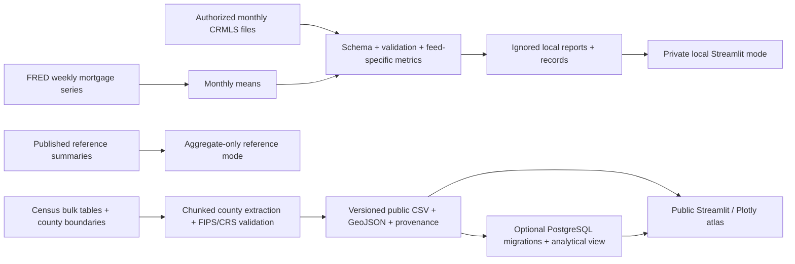

# Architecture and trade-offs

Streamlit is the simplest stack for the reference's existing Python/dataframe workflow. Separate modules
keep ingestion, analytics, presentation and external IO independent. Data contracts are validated at source
and UI/SQL boundaries; typed functions/dataclass configuration provide internal contracts without an unused API.
No Next.js, FastAPI or authentication service is needed for a read-only public county demo.

Granularity is explicit: monthly CRMLS file records, upstream field summaries and ACS county-year estimates
never share a fabricated observation model. Listing/sold feeds are not pooled for market statistics.
An unmatched mortgage month does not erase housing data. We do not automatically deduplicate monthly
listing snapshots without a source-specific revision/event policy; file lineage and key diagnostics expose repeats.

GeoPandas reprojects declared polygon CRS into EPSG:4326 for joins. Strict `within` leaves boundary points
unmatched. Overlapping polygon matches fail rather than duplicating records. Display polygons are generalized;
use detailed authoritative boundaries for production point assignment near borders/coasts.

CSV is sufficient for 174 public rows. PostgreSQL adds constrained keys, transaction-safe migration/upsert,
inspectable SQL and an optional read backend. PostGIS is justified only when future requirements demand
large interactive server-side spatial queries. Current batch spatial work stays in GeoPandas.

Operational limits: ingest currently materializes CRMLS frames in memory (Census bulk tables are chunked),
so full MLS feed memory/runtime must be benchmarked against authorized files. Outputs are deterministic
but not atomically published as a group. Snapshot versioning, source-specific deduplication, more extensive
schema contracts and production monitoring belong in the next hardening iteration.
